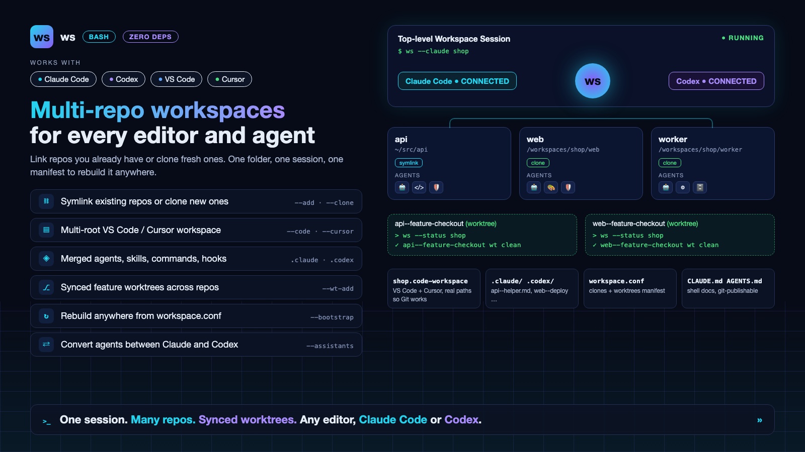

# ws: one workspace for many git repos

[](https://github.com/RaviDasari/workspaces/actions/workflows/build.yml)
[](https://github.com/RaviDasari/workspaces/actions/workflows/test.yml)
[](https://github.com/RaviDasari/workspaces/actions/workflows/lint.yml)
[](https://github.com/RaviDasari/workspaces/releases/latest)
[](LICENSE)
[](https://github.com/RaviDasari/homebrew-tap)


**Group your repos into one workspace, then open it in VS Code, Cursor, Claude Code or Codex with every repo in reach.** A single bash file, no dependencies.

- **One workspace, any editor:** link repos you already have or clone new ones; `ws` writes the VS Code / Cursor multi-root file and the Claude Code config.
- **Worktrees across repos:** one command per feature branch, in every repo.
- **Agents see everything:** every repo's agents and skills merged into one Claude Code or Codex session.
- **Portable:** rebuild the whole workspace on another machine from a manifest; checkpoint and restore every repo at once.



```bash
brew install RaviDasari/tap/ws
ws --create shop && ws --add shop ~/code/api && ws --add shop ~/code/web && ws --claude shop
```

**[Install](#install)** · **[Quick start](#quick-start)** · **[Features](#clone-based-workspaces)** · **[Commands](#commands)** · **[How it compares](#why-ws)**

## Install

Homebrew:

```bash
brew install RaviDasari/tap/ws
```

Or from source. Requires bash and `realpath`. Clone, worktree, and publish features also need `git` (and `gh` for `--publish` without a url).

```bash
git clone https://github.com/<you>/ws.git
cd ws
install -m 755 ws ~/.local/bin/ws
```

Or keep the clone and point the command at it:

```bash
ln -sfn "$PWD/ws" ~/utils/ws
```

Workspaces live in `~/workspaces` by default. To keep them somewhere else, set it once:

```bash
ws --config root ~/code/workspaces   # saved in ~/.config/ws/config
ws --config                          # show the folder in use and where it came from
ws --config root --unset             # back to the default
ws --setup                           # create the folder if it does not exist yet
```

Override it for a single run, or per shell:

```bash
ws --root /tmp/scratch --create demo
WS_ROOT=/tmp/scratch ws --list
```

Precedence, first match wins: `--root <dir>`, the `WS_ROOT` environment variable, the saved config, then `~/workspaces`. If you already have a `/workspaces` folder and no `~/workspaces`, `ws` keeps using `/workspaces` until you pick a folder.

## Quick start

```bash
ws --create shop
ws --add shop ~/src/api
ws --add shop ~/src/web web
ws --show shop
```

`web` is the name inside the workspace. Omit it to use the directory's basename.

Anywhere a workspace name is expected you can type its number from `ws --list` instead:

```text
$ ws --list
  1  shop                     3 project(s)
  2  infra                    2 project(s)
$ ws --open 2        # same as: ws --open infra
$ ws --code 1
```

Run `--open`, `--code`, `--cursor`, `--claude`, `--cd`, `--show`, `--status`, `--pull` or `--fetch` with no name at a terminal and `ws` shows that list and asks. A workspace whose real name is all digits is still matched by name first. Numbers change when workspaces are added or removed, so use names in scripts.

Inside a workspace (any directory under it, including through a symlinked project) you can leave the name out of every command except `--delete` and `--rename`:

```text
$ cd ~/workspaces/shop/api
$ ws --status          # same as: ws --status shop
$ ws --wt-add feat-x   # worktree in every shop repo
```

`ws --list` marks the current workspace with `*`. If the first argument is another workspace's name or number, it is read as the workspace, so type the name out when a repo or branch looks like one. `ws --sync` with no name inside a workspace syncs only that one.

Every child directory is included, whether or not it is a Git repository. Broken symlinks are skipped. Loose files in the workspace folder stay on disk and are not editor roots.

## Clone-based workspaces

Instead of linking repos you already have, let `ws` clone them:

```bash
ws --create shop git@github.com:acme/api.git https://github.com/acme/web.git
ws --clone shop git@github.com:acme/worker.git              # directory defaults to "worker"
ws --clone shop git@github.com:acme/web.git web-next -b next # custom dir, branch
```

Clones are recorded in `workspace.conf`, in the same format virtual-workspace uses:

```bash
REPOS=(
  "api|git@github.com:acme/api.git"
  "web-next|git@github.com:acme/web.git|next"
  "web--feature-pay|worktree:web|feature/pay"
)
```

Commit that file (see `--publish`), and on another machine:

```bash
git clone <shell-repo-url> "$(ws --config root)/shop"
ws --bootstrap shop      # clones what is missing, recreates worktrees, relinks. Safe to rerun.
```

Symlinked and cloned projects mix freely in one workspace. Only clones and worktrees are recorded in `workspace.conf`, because symlink targets are specific to one machine.

## Merged agents, skills, commands, hooks

On every sync, `<project>/.claude/{agents,commands,skills,hooks}/*` is linked as `.claude/<kind>/<project>--<item>` in the workspace, and `<project>/.codex/{agents,skills}/*` the same way under `.codex/`. Start `claude` or `codex` in the workspace directory and you get the union, without name collisions. Links are relative; dead ones are pruned; your own files in those folders are left alone.

Convert between the two tools inside each project:

```bash
ws --assistants shop codex    # .claude agents/skills -> .codex  (bare .md skills get frontmatter)
ws --assistants shop claude   # .codex -> .claude
ws --assistants shop both
```

This writes into the projects' own `.claude`/`.codex` folders and overwrites same-named files there. It prints every file it copies.

## Worktrees across repos

```bash
ws --wt-add shop feature/checkout          # <repo>--feature-checkout for every repo
ws --wt-add shop feature/checkout api web  # only these
ws --status shop
ws --fetch shop                            # git fetch --all --prune everywhere
ws --pull shop                             # git pull --ff-only everywhere, reports failures, keeps going
ws --wt-rm shop feature/checkout           # dirty worktrees are skipped; branches are kept
ws --wt-rm shop feature/checkout --delete-branch   # also drop each branch git considers merged
```

Set a new worktree up in the same command. `--copy` brings untracked files such as `.env` over from the source repo (relative paths only), and `--run` runs a command in each new worktree. A failing `--run` is reported and does not stop the rest.

```bash
ws --wt-add shop feature/checkout --copy .env,.env.local --run "npm ci"
```

A new worktree uses the existing local branch, else `origin/<branch>`, else a new branch from HEAD. Worktrees are real directories in the workspace, so they appear in the editor workspace, in Claude's `--add-dir` list, and in the merged agent links. `--wt-add` is incremental: it skips worktrees that already exist.

`--status` prints one row per project:

```text
DIRECTORY                      TYPE   BRANCH                    AGE   STATUS
------------------------------ ------ ------------------------- ----- ------
api                            clone  main                      2d    clean
api--feature-checkout          wt     feature/checkout          3h    dirty (2 files) [+3/-0]
api--old-fix                   wt     old-fix                   41d   clean merged
web                            link   main                      5m    clean
```

`AGE` is the last commit. `merged` means the branch is fully contained in the default branch, and `upstream-gone` means its remote branch was deleted. Both are cleanup candidates. `--status` reads local data only, so run `ws --fetch` first when you need fresh remote state.

## Run a command everywhere

```bash
ws --exec shop -- git log -1 --oneline
ws --exec shop --git-only -- git switch main
ws --exec shop --only api,web -- npm test
```

Output is grouped under a `=== project ===` header. It keeps going when a project fails and exits 1 at the end if any did. This runs arbitrary commands in every project, so read it before you press enter.

## Checkpoints

A checkpoint is a save point for the whole workspace. Take one before a risky change that spans repos, such as a refactor or an agent run, and go back with a single command if it goes wrong.

```bash
ws --checkpoint shop before-refactor     # label defaults to a timestamp
ws --checkpoint shop --only api,web wip  # only these projects
ws --checkpoint shop --list              # --json too
ws --restore shop before-refactor
ws --restore shop before-refactor --only api
ws --checkpoint shop --rm before-refactor
```

For every git project, a checkpoint records the branch, the commit, staged and unstaged changes, and untracked files. Your files, index, and branches stay as they are. Ignored files (`node_modules`, `.env`) are not saved, and `--restore` leaves them alone too.

`--restore` puts each project back exactly. It checks out the saved branch, resets it to the saved commit (dropping commits made since), restores staged and unstaged changes, and deletes untracked files created after the checkpoint. Before it changes anything, it saves the current state as `pre-restore-<time>`, so a restore can be undone with the command it prints.

Claude Code and Cursor have their own checkpoints, but those cover only the files the assistant edited in one session. These cover every repo in the workspace, including commits, branch switches, and anything run from a shell.

Each project gets one commit, shaped like a `git stash` entry, kept alive by a ref under `refs/ws-checkpoints/` so `git gc` cannot remove it. The list of checkpoints lives in `.ws/checkpoints/`, which is not published. Checkpoints are local to this machine: they are never pushed, and `--rm` and `--delete` remove their refs. Linked projects are your real repos, so restoring a workspace also restores them. A project in the middle of a merge or rebase is skipped.

## For scripts and agents

`--list`, `--show` and `--status` take `--json`:

```bash
ws --list --json
ws --status shop --json | jq '.[] | select(.merged) | .name'
```

`mods/ws-skill` is a Claude Code plugin that teaches Claude to use these commands, with rules about which ones it should not run on its own. Install it the same way as `/repos`:

```bash
claude plugin marketplace add RaviDasari/workspaces && claude plugin install ws-skill@ws
```

## VS Code and Cursor

Both editors open the same file:

```bash
ws --code shop
ws --cursor shop
```

That runs `code` or `cursor` on `<workspace>/shop.code-workspace`. Set `WS_CODE_BIN` or `WS_CURSOR_BIN` if the command has another name.

Open that file with **File → Open Workspace from File…**. Opening the symlink folder instead shows a single directory and, in Source Control, no repository for the linked projects.

The workspace file stores absolute paths. After you move a project, run `ws --sync shop`.

## Claude Code

Two ways to open the same workspace:

```bash
# File access, skills, and (via an env var) each project's CLAUDE.md.
ws --claude shop

# Git status follows one project. The others are still --add-dir.
ws --claude shop --repo web

# Anything after the name is passed through to claude.
ws --claude shop -- --resume
```

Or start Claude yourself from the workspace directory:

```bash
cd "$(ws --config root)/shop"
claude
```

That session reads `.claude/settings.local.json`, which lists each project under `permissions.additionalDirectories`. That grants file access only. It does not load `CLAUDE.md`, rules, or skills from those projects. `ws --claude` uses `--add-dir`, which does load skills, and it sets `CLAUDE_CODE_ADDITIONAL_DIRECTORIES_CLAUDE_MD=1` so each project's `CLAUDE.md` and `.claude/rules/` are loaded too.

`ws` will not overwrite a `.claude/settings.local.json` it did not create. Move your own settings aside or merge `additionalDirectories` yourself, then run `ws --sync`.

Claude's Git status follows the directory you start in. The symlink folder is not a repository. Use `--repo <linkname>` when you want Claude's Git view to be one of the projects.

## Claude Code mod: `/repos`

`mods/repos-overview` adds a `/repos` slash command to Claude Code. It lists every git repo in the session directory with its branch, ahead/behind, and a short count of staged, modified, and untracked files. Start Claude in a workspace (`ws --claude <name>`) and run `/repos`.

Install it with one command from any terminal:

```bash
claude plugin marketplace add RaviDasari/workspaces && claude plugin install repos-overview@ws
```

Or inside Claude Code:

```text
/plugin marketplace add RaviDasari/workspaces
/plugin install repos-overview@ws
```

It then loads in every session. Update with `claude plugin marketplace update ws`, remove with `claude plugin uninstall repos-overview@ws`.

To try it without installing: `claude --plugin-dir mods/repos-overview`.

## Commands

```text
ws --setup
ws --config [root [<dir>|--unset]]
ws --root <dir> <command> ...
ws --create <name> [git-url...]
ws --clone <name> <url> [dir] [-b branch]
ws --bootstrap <name>
ws --pull <name>
ws --fetch <name>
ws --status <name> [--json]
ws --exec <name> [--only a,b] [--git-only] -- <command...>
ws --wt-add <name> <branch> [--run <cmd>] [--copy <f,f>] [repo...]
ws --checkpoint <name> [label] [--only a,b]
ws --checkpoint <name> --list [--json] | --rm <label...>
ws --restore <name> <label> [--only a,b]
ws --wt-rm <name> <branch> [--delete-branch] [repo...]
ws --assistants <name> codex|claude|both
ws --publish <name> [git-url]
ws --add <name> <path> [linkname]
ws --remove <name> <linkname>
ws --rename <old> <new>
ws --delete <name>
ws --list [--json]
ws --show <name> [--json]
ws --sync [name]
ws --open <name>          # herdr, or tmux
ws --code <name>
ws --cursor <name>
ws --claude <name> [--repo <link>] [--] [claude args...]
ws --cd <name>
ws --completion bash|zsh|fish
```

`--delete` removes symlinks and generated configs. It asks first, and it refuses if the workspace contains any other real file or directory, including clones and worktrees. Project directories are never deleted.

`--cd` only changes directory when a shell function wraps `ws`. Otherwise it prints the path.

## Shell completion

```bash
echo 'eval "$(ws --completion bash)"' >> ~/.bashrc
echo 'eval "$(ws --completion zsh)"'  >> ~/.zshrc
ws --completion fish > ~/.config/fish/completions/ws.fish
```

zsh needs `compinit` loaded first (`autoload -Uz compinit && compinit` earlier in `~/.zshrc`). Completes options, workspace names, project names, and the flags above. The bash script is tested; zsh is only syntax-checked and fish is untested.

## Publishing the workspace shell

```bash
ws --publish shop                          # private GitHub repo via gh
ws --publish shop git@github.com:me/shop.git
```

Asks first, then commits only `.gitignore`, `CLAUDE.md`, `AGENTS.md`, `README.md`, and `workspace.conf`. Project contents are never tracked.


## Why ws

Several tools manage many repos or many worktrees. `ws` is the one that also sets up the editor and the AI assistant for the group.

| | `ws` | [virtual-workspace](https://github.com/filipealva/virtual-workspace) | [Canopy](https://github.com/ashmitb95/canopy-cli) | [Grove](https://github.com/nicksenap/grove) | [mani](https://github.com/alajmo/mani) / [meta](https://github.com/mateodelnorte/meta) | [Worktrunk](https://github.com/max-sixty/worktrunk) |
| --- | --- | --- | --- | --- | --- | --- |
| Many repos as one unit | yes | yes | yes | yes | yes | no (one repo) |
| Link repos you already have | yes | no | partial (`init` discovers repos) | partial (registers repo folders) | yes | partial (works in any clone) |
| Worktree per repo, same branch | yes | yes | yes | yes | mani: partial, meta: no | yes (one repo) |
| VS Code / Cursor multi-root file | yes | no | undocumented | undocumented | undocumented | no |
| Claude Code / Codex config merged across repos | yes | yes | no (MCP server and a skill) | no (a skill that teaches agents `gw`) | undocumented | no (Claude Code plugin) |
| Run a command in every repo | yes | no | one repo at a time | partial (fixed git commands: status, sync) | yes | across one repo's worktrees |
| Checkpoint and restore every repo at once | yes | no | no (feature-tagged stash only) | undocumented | undocumented | no (per-branch backup only) |
| Machine-readable output for agents | `--json` + a Claude skill | no | `--json` + MCP server | `-o json` + MCP server + a skill | mani: no, meta: undocumented | `--format=json` + Claude Code plugin |
| Install | one bash file | scripts | Python | Python or Go | Go / Node | Rust |

Checked against each project's README and docs in November 2026; nothing was installed or run. "Undocumented" means the pages I read do not mention it, not that the feature is absent. Canopy's original repo is now a VS Code extension, so the link goes to its CLI, `canopy-cli`. Grove's docs pages were partly unreachable, so check its repo before relying on its column.

Use something else if you want an MCP server rather than a CLI the agent shells out to (Canopy), or a task runner with tags and a YAML config (mani).

It covers everything [virtual-workspace](https://github.com/filipealva/virtual-workspace) does (clone-based workspaces, `workspace.conf`, merged `.claude`/`.codex` config, assistant conversion, pull, worktrees, status, publishing) and adds symlinked projects, VS Code/Cursor workspaces, Claude `--repo` mode, and tmux/herdr. The difference is that `ws` is a plain bash command, so it works from any shell and needs no plugin.

The symlink folder is for the shell. Editors and Claude Code do not treat that folder as a multi-repo workspace on their own: the folder is not a Git repository, and editor Git discovery skips symlinks. `ws` records the real directory of each project and regenerates:

| File | Used by |
| --- | --- |
| `<name>.code-workspace` | VS Code and Cursor. One workspace folder per project, using the real path so Git is detected. |
| `.claude/settings.local.json` | Claude Code, when you start it in the workspace directory. Grants file access to each project. |
| `.ws/claude.sh` | `ws --claude`. Starts Claude with `--add-dir` for every project so skills are loaded too. |
| `.claude/{agents,commands,skills,hooks}/<project>--<item>`, `.codex/{agents,skills}/…` | Symlinks that merge every project's assistant config, so a session started in the workspace sees all of it. |
| `workspace.conf` | Manifest of clones and worktrees. `ws --bootstrap` rebuilds from it. |
| `CLAUDE.md`, `AGENTS.md`, `README.md` | Written once, then yours. |
| `.gitignore` | Regenerated, so the workspace shell can be its own git repo that never tracks project contents. |

Everything except the three docs is rewritten by `--add`, `--remove`, `--rename`, `--sync`, `--code`, `--cursor`, and `--claude`. Edit the symlink list, not the generated files.

## Development

`ws` is one file you can install anywhere, but it is built from `src/*.sh`, which are joined in filename order.

```bash
$EDITOR src/70-git.sh
./build.sh           # rewrites ./ws
./build.sh --check   # exits 1 if ./ws is stale
bash tests/smoke.sh  # runs ws against a temp folder; no network
```

Commit `ws` together with `src/`. The smoke test fails if they disagree.

Three workflows run on every push and PR: Build (`./build.sh --check`), Test (the smoke test on Ubuntu and macOS, also under macOS `/bin/bash` 3.2) and Lint (shellcheck). Run `shellcheck build.sh tests/smoke.sh src/*.sh` locally to match.

### Releasing

1. Add a `## X.Y.Z` section to `CHANGELOG.md`. Its text becomes the release notes.
2. Commit, then `git tag vX.Y.Z && git push origin main vX.Y.Z`.

The Release workflow reruns the checks, publishes the GitHub release, and updates `Formula/ws.rb` in [`RaviDasari/homebrew-tap`](https://github.com/RaviDasari/homebrew-tap) with the new tarball URL and sha256. It needs the repo secret `HOMEBREW_TAP_TOKEN`: a fine-grained token with Contents read/write on the tap only. It expires, so regenerate it and re-run `gh secret set HOMEBREW_TAP_TOKEN` if the tap step fails with a 401 or 403.

## License

MIT. See [LICENSE](LICENSE).
