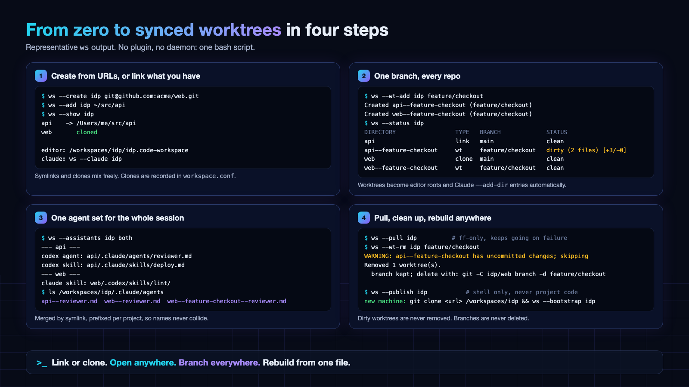

# ws

`ws` groups repositories into one workspace folder, whether they are symlinks to repos you already have or fresh clones, then writes the files VS Code, Cursor, Claude Code, and Codex need to open that group again. It also manages feature worktrees across repos, merges every repo's agents and skills into one session, and can rebuild the whole workspace on another machine from a manifest.


It covers everything [virtual-workspace](https://github.com/filipealva/virtual-workspace) does (clone-based workspaces, `workspace.conf`, merged `.claude`/`.codex` config, assistant conversion, pull, worktrees, status, publishing) and adds symlinked projects, VS Code/Cursor workspaces, Claude `--repo` mode, and tmux/herdr. The difference is that `ws` is a plain bash command, so it works from any shell and needs no plugin.

The symlink folder is for the shell. Editors and Claude Code do not treat that folder as a multi-repo workspace on their own: the folder is not a Git repository, and editor Git discovery skips symlinks. `ws` records the real directory of each project and regenerates:

| File | Used by |
| --- | --- |
| `<name>.code-workspace` | VS Code and Cursor. One workspace folder per project, using the real path so Git is detected. |
| `.claude/settings.local.json` | Claude Code, when you start it in the workspace directory. Grants file access to each project. |
| `.ws/claude.sh` | `ws --claude`. Starts Claude with `--add-dir` for every project so skills are loaded too. |
| `.claude/{agents,commands,skills,hooks}/<project>--<item>`, `.codex/{agents,skills}/…` | Symlinks that merge every project's assistant config, so a session started in the workspace sees all of it. |
| `workspace.conf` | Manifest of clones and worktrees. `ws --bootstrap` rebuilds from it. |
| `CLAUDE.md`, `AGENTS.md`, `README.md` | Written once, then yours. |
| `.gitignore` | Regenerated, so the workspace shell can be its own git repo that never tracks project contents. |

Everything except the three docs is rewritten by `--add`, `--remove`, `--rename`, `--sync`, `--code`, `--cursor`, and `--claude`. Edit the symlink list, not the generated files.

## Install

Homebrew:

```bash
brew install RaviDasari/tap/ws
```

Or from source. Requires bash and `realpath`. Clone, worktree, and publish features also need `git` (and `gh` for `--publish` without a url).

```bash
git clone https://github.com/<you>/ws.git
cd ws
install -m 755 ws ~/.local/bin/ws
```

Or keep the clone and point the command at it:

```bash
ln -sfn "$PWD/ws" ~/utils/ws
```

Workspaces live in `/workspaces` unless you set `WS_ROOT`.

```bash
ws --setup          # only if /workspaces does not exist yet
```

## Quick start

```bash
ws --create idp
ws --add idp ~/src/api
ws --add idp ~/src/web web
ws --show idp
```

`web` is the name inside the workspace. Omit it to use the directory's basename.

Every child directory is included, whether or not it is a Git repository. Broken symlinks are skipped. Loose files in the workspace folder stay on disk and are not editor roots.

## Clone-based workspaces

Instead of linking repos you already have, let `ws` clone them:

```bash
ws --create idp git@github.com:acme/api.git https://github.com/acme/web.git
ws --clone idp git@github.com:acme/worker.git              # directory defaults to "worker"
ws --clone idp git@github.com:acme/web.git web-next -b next # custom dir, branch
```

Clones are recorded in `workspace.conf`, in the same format virtual-workspace uses:

```bash
REPOS=(
  "api|git@github.com:acme/api.git"
  "web-next|git@github.com:acme/web.git|next"
  "web--feature-pay|worktree:web|feature/pay"
)
```

Commit that file (see `--publish`), and on another machine:

```bash
git clone <shell-repo-url> /workspaces/idp
ws --bootstrap idp      # clones what is missing, recreates worktrees, relinks. Safe to rerun.
```

Symlinked and cloned projects mix freely in one workspace. Only clones and worktrees are recorded in `workspace.conf`, because symlink targets are specific to one machine.

## Merged agents, skills, commands, hooks

On every sync, `<project>/.claude/{agents,commands,skills,hooks}/*` is linked as `.claude/<kind>/<project>--<item>` in the workspace, and `<project>/.codex/{agents,skills}/*` the same way under `.codex/`. Start `claude` or `codex` in the workspace directory and you get the union, without name collisions. Links are relative; dead ones are pruned; your own files in those folders are left alone.

Convert between the two tools inside each project:

```bash
ws --assistants idp codex    # .claude agents/skills -> .codex  (bare .md skills get frontmatter)
ws --assistants idp claude   # .codex -> .claude
ws --assistants idp both
```

This writes into the projects' own `.claude`/`.codex` folders and overwrites same-named files there. It prints every file it copies.

## Worktrees across repos

```bash
ws --wt-add idp feature/checkout          # <repo>--feature-checkout for every repo
ws --wt-add idp feature/checkout api web  # only these
ws --status idp
ws --pull idp                             # git pull --ff-only everywhere, reports failures, keeps going
ws --wt-rm idp feature/checkout           # dirty worktrees are skipped; branches are kept
```

A new worktree uses the existing local branch, else `origin/<branch>`, else a new branch from HEAD. Worktrees are real directories in the workspace, so they appear in the editor workspace, in Claude's `--add-dir` list, and in the merged agent links. `--wt-add` is incremental: it skips worktrees that already exist.

`--status` prints one row per project:

```text
DIRECTORY                      TYPE   BRANCH                    STATUS
------------------------------ ------ ------------------------- ------
api                            clone  main                      clean
api--feature-checkout          wt     feature/checkout          dirty (2 files) [+3/-0]
web                            link   main                      clean
```

## Publishing the workspace shell

```bash
ws --publish idp                          # private GitHub repo via gh
ws --publish idp git@github.com:me/idp.git
```

Asks first, then commits only `.gitignore`, `CLAUDE.md`, `AGENTS.md`, `README.md`, and `workspace.conf`. Project contents are never tracked.



## VS Code and Cursor

Both editors open the same file:

```bash
ws --code idp
ws --cursor idp
```

That runs `code` or `cursor` on `<workspace>/idp.code-workspace`. Set `WS_CODE_BIN` or `WS_CURSOR_BIN` if the command has another name.

Open that file with **File → Open Workspace from File…**. Opening the symlink folder instead shows a single directory and, in Source Control, no repository for the linked projects.

The workspace file stores absolute paths. After you move a project, run `ws --sync idp`.

## Claude Code

Two ways to open the same workspace:

```bash
# File access, skills, and (via an env var) each project's CLAUDE.md.
ws --claude idp

# Git status follows one project. The others are still --add-dir.
ws --claude idp --repo web

# Anything after the name is passed through to claude.
ws --claude idp -- --resume
```

Or start Claude yourself from the workspace directory:

```bash
cd /workspaces/idp
claude
```

That session reads `.claude/settings.local.json`, which lists each project under `permissions.additionalDirectories`. That grants file access only. It does not load `CLAUDE.md`, rules, or skills from those projects. `ws --claude` uses `--add-dir`, which does load skills, and it sets `CLAUDE_CODE_ADDITIONAL_DIRECTORIES_CLAUDE_MD=1` so each project's `CLAUDE.md` and `.claude/rules/` are loaded too.

`ws` will not overwrite a `.claude/settings.local.json` it did not create. Move your own settings aside or merge `additionalDirectories` yourself, then run `ws --sync`.

Claude's Git status follows the directory you start in. The symlink folder is not a repository. Use `--repo <linkname>` when you want Claude's Git view to be one of the projects.

## Commands

```text
ws --setup
ws --create <name> [git-url...]
ws --clone <name> <url> [dir] [-b branch]
ws --bootstrap <name>
ws --pull <name>
ws --status <name>
ws --wt-add <name> <branch> [repo...]
ws --wt-rm <name> <branch> [repo...]
ws --assistants <name> codex|claude|both
ws --publish <name> [git-url]
ws --add <name> <path> [linkname]
ws --remove <name> <linkname>
ws --rename <old> <new>
ws --delete <name>
ws --list
ws --show <name>
ws --sync [name]
ws --open <name>          # herdr, or tmux
ws --code <name>
ws --cursor <name>
ws --claude <name> [--repo <link>] [--] [claude args...]
ws --cd <name>
```

`--delete` removes symlinks and generated configs. It asks first, and it refuses if the workspace contains any other real file or directory, including clones and worktrees. Project directories are never deleted.

`--cd` only changes directory when a shell function wraps `ws`. Otherwise it prints the path.

## Claude Code mod: `/repos`

`mods/repos-overview` adds a `/repos` slash command to Claude Code. It lists every git repo in the session directory with its branch, ahead/behind, and a short count of staged, modified, and untracked files. Start Claude in a workspace (`ws --claude <name>`) and run `/repos`.

```bash
claude --plugin-dir "$(brew --prefix)/share/ws/mods/repos-overview"   # Homebrew install
claude --plugin-dir mods/repos-overview                                # from a clone
```

## License

MIT. See [LICENSE](LICENSE).
